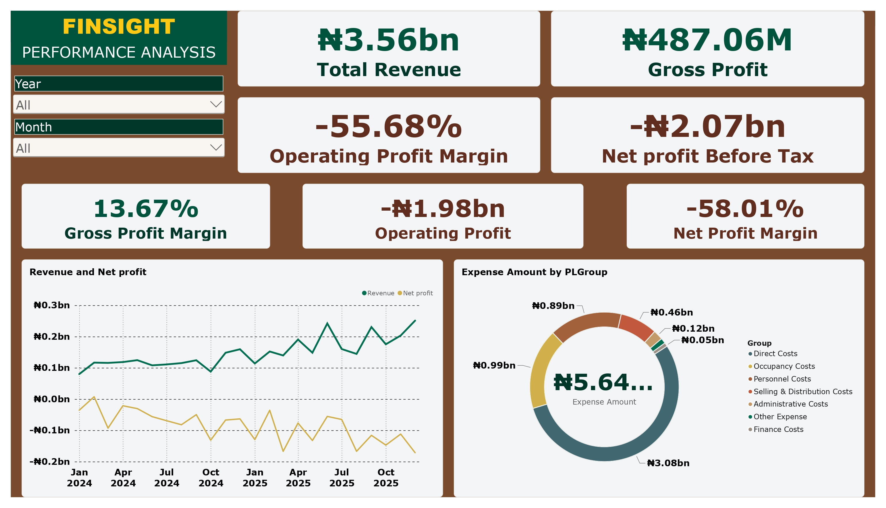
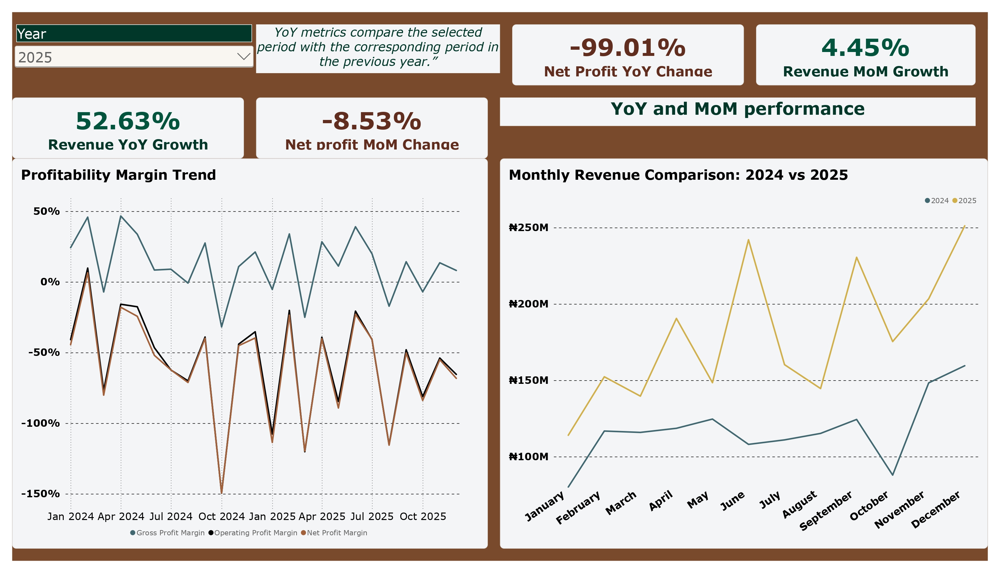
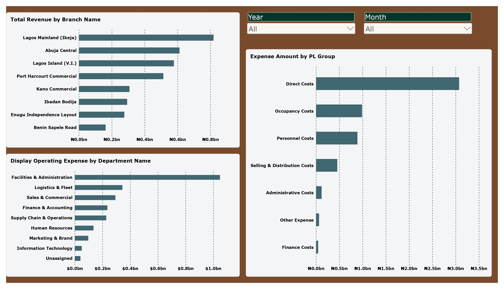
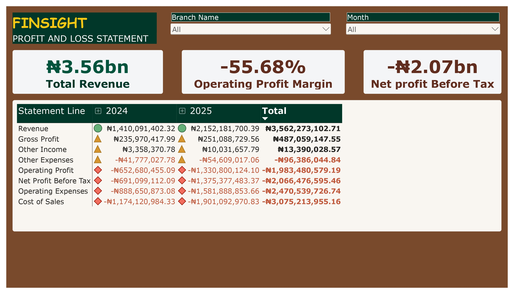

## FinSight Financial Analytics
Financial analytics and business intelligence project using Power BI, featuring financial performance analysis, interactive dashboards, and Profit &amp; Loss reporting.

## Project Overview
FinSight Financial Analytics is a business intelligence project developed using Microsoft Power BI to analyse the financial performance of FinSight Distribution & Consumer Products Ltd.

The project transforms financial transaction data into interactive dashboards and a structured Profit & Loss statement, providing insights into revenue growth, profitability, expense patterns, branch performance and departmental cost efficiency.

# Business Problem
Despite significant revenue growth between 2024 and 2025, the business experienced increasing expenses and declining profitability.

The objective of this project is to investigate the factors behind this performance gap and provide management with actionable insights to improve financial performance and operational efficiency.

# Tools and Technology
- Ms Excel : Source data
- Microsoft Power BI
- Power Query : used for data cleaning and Transformation
- DAX : For Financial measures and time intelligence
- GitHub : Project documentation and version control

# Project Deliverables
1. Executive Overview
Provides a high-level view of financial performance through KPI cards, revenue trends, profitability margins and expense breakdowns.

2. Financial Performance
Examines year-over-year and month-over-month performance, revenue comparisons and profitability margin trends.

3. Operational Analysis
Evaluates revenue contributions by branch, expense categories and operating expenses by department.

4. Profit and Loss Statement
Presents a structured monthly Profit & Loss statement covering revenue, cost of sales, gross profit, operating expenses, operating profit and net profit before tax.

# Key Fiancial Findings
The table below highlights the company's financial performance in 2024 and 2025
| Financial Metric | 2024 | 2025 |
|---|---:|---:|
| Revenue | #1.41bn | #2.15bn |
| Gross Profit | #235.97m | #251.09m |
| Operating Expenses | #888.65m | #1.58bn |
| Net Profit Before Tax | -#691.10m | -#1.28bn |

# Key Observations
- Revenue increased by approximately 52.63%.
- Gross profit increased by only approximately 6.40%.
- Operating expenses grew significantly faster than revenue.
- Gross profit margin declined from approximately 17.00% to 11.67%.
- Net losses increased between 2024 and 2025.

# Strategic Recommendations
1. Control operating expenses: Review major cost drivers, particularly staff salaries, generator fuel and outbound freight.
2. Improve gross profit margins: Review product pricing, procurement costs and cost of goods sold.
3. Strengthen operational efficiency: Monitor branch and departmental performance to identify opportunities for cost optimization.

# Project Skills Demonstrated
- Data cleaning and transformation
- Data modelling and relationship management
- DAX calculations and financial measures
- Time intelligence analysis
- Interactive dashboard development
- Financial reporting and business analysis
- Data storytelling and management recommendations

# Conclusion
This project demonstrates how business intelligence tools can transform raw financial transactions into meaningful insights that support strategic decision-making, financial monitoring and operational improvement.
